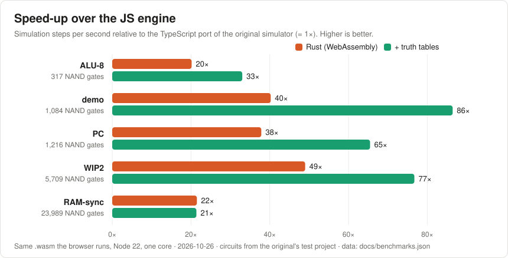

# Performance

The web version simulates **20–86× faster than a straight TypeScript port of the original simulator**. It produces
the same results step for step. This page covers the measurements, where the speed comes from, and how to
reproduce them.



All numbers are in [`benchmarks.json`](benchmarks.json). The chart is generated from that file with
`bun scripts/perfChart.ts`.

## What is compared

| Engine | What it is | How to select it |
| --- | --- | --- |
| **JS engine** | The TypeScript port of the original C# simulator (`src/dls/simulation/Simulator.ts`), line by line | Settings → Sim engine → JS (ORIGINAL), or `?engine=js` |
| **Rust** | The Rust engine (`rust/dls-sim`) compiled to WebAssembly, with truth tables off | Settings → Truth tables → OFF, or `?tables=0` |
| **Rust + truth tables** | The same, with exact truth tables for combinational chips (default) | Default |

The test circuits come from the original's own test project (`testdata/Projects/MainTest`):

| Circuit | What it is | NAND gates | All builtin chips | Wires (flattened) |
| --- | --- | --- | --- | --- |
| ALU-8 | 8-bit ALU | 317 | 396 | 1,609 |
| demo | 7-segment display demo | 1,084 | 1,125 | 4,381 |
| PC | 8-bit program counter (adder, registers, mux) | 1,216 | 1,256 | 4,945 |
| WIP2 | Work-in-progress CPU | 5,709 | 5,979 | 23,381 |
| RAM-sync | 256-byte RAM built from NAND latches | 23,989 | 26,605 | 95,640 |

## Results

### WebAssembly (what the browser runs)

Measurement setup:
- Command: `bun run bench` (Vitest bench in Node 22).
- Module: the same `dls_sim.wasm` the app loads.
- Hardware: one core of a 2.1 GHz Xeon.
- Workload: inputs change every 100 steps and the clock toggles, so the circuit keeps working.

| Circuit | JS engine | Rust | Rust + truth tables |
| --- | --- | --- | --- |
| ALU-8 | 21,783 | 439,254 (20×) | **719,394 (33×)** |
| demo | 6,021 | 242,308 (40×) | **520,495 (86×)** |
| PC | 5,353 | 202,621 (38×) | **350,493 (65×)** |
| WIP2 | 705 | 34,541 (49×) | **54,089 (77×)** |
| RAM-sync | 164 | **3,526 (21×)** | 3,505 (21×) |

Steps per second; speed-ups are relative to the JS engine.

### In the app

Measured with `bun run e2e`: headless Chromium, RAM-sync, target rate unlimited.

| Circuit | JS engine | Rust + truth tables |
| --- | --- | --- |
| RAM-sync | ~235 steps/s | ~3,500–4,000 steps/s |

The simulation runs in a Web Worker, so rendering doesn't slow it down. With the default target of 1,000 steps/s, the
JS engine can only keep up on circuits up to a few thousand gates; the Rust engine can do so up to tens of thousands.

### Native Rust (where the speed comes from)

Measured with `bun run bench:rust` (Rust 1.97, release build, same machine). Each column adds one technique.

| Circuit | Reference step | + compiled program | + truth tables | Table build time |
| --- | --- | --- | --- | --- |
| ALU-8 | 44,711 | 619,879 | 1,029,250 | 21 ms |
| PC | 14,584 | 310,635 | 640,531 | 14 ms |
| demo | 13,751 | 331,520 | 520,297 | 2 ms |
| WIP2 | 1,379 | 48,916 | 65,047 | 30 ms |
| RAM-sync | 335 | 3,582 | 3,593 | 42 ms |

The **reference step** is a direct Rust port of the original's recursive `StepChip`: same algorithm, same data
walk. It is only **2.0–2.7× faster than the JS engine**, so the language accounts for a small part of the gain. The
rest comes from changing how each step is executed.

## Where the speed comes from

Full details are in [rust-engine.md](rust-engine.md). Steps 1–3 together make the compiled program 11–35× faster
than the reference step (column 2 vs column 1 above). In short:

1. **Compiling the circuit.** The original walks the chip tree every step: for each chip it
   propagates the input pins, recurses into subchips, and propagates the outputs. Except on rare "special" frames,
   that order never changes. The Rust engine unrolls it once into a flat list of operations, one per wire and one
   per gate, and replays that list. A wire into a pin with a single source becomes a plain copy.
2. **Skipping bookkeeping that is never read.** The original updates a per-chip "inputs ready" counter on every
   wire, every step. It is only read on the frame after an edit and on every 100th frame. Its exact value can be
   computed from the program order, so the fast path doesn't track it, and restores it before those frames.
3. **Removing redundant copies (about 2× on large circuits).** A compile pass proves which wire copies never change what any
   gate reads, and makes readers read the source directly. This removes about 65% of the operations in large
   circuits.
4. **Truth tables (1.5–2.1× on circuits built from logic gates).** A custom chip with no memory and no feedback,
   such as an adder, decoder or ALU slice, is simulated once for every input combination (up to 16 input bits).
   After that it is a single table lookup.
   - The original also evaluates such a chip completely within its turn, so the lookup returns exactly what full
     simulation would.
   - RAM-sync is almost entirely latches (feedback), so tables don't help it.
5. **WebAssembly.** The browser runs the Rust engine compiled to WebAssembly at close to native speed.

## Correctness

Speed doesn't change behaviour:

- The compiled program matches the reference step **bit for bit**: every pin state on every step, the ready
  counters, internal memory and chip order. This is checked on every chip in the original's test project, with
  random inputs and with edits in the middle of a run (`rust/dls-sim/tests/equivalence.rs`).
- Truth tables give identical outputs on combinational chips. Registers, the program counter and RAM still behave
  correctly with tables on.
- `tests/engines.test.ts` runs the same behavioural tests against the JS engine and the WebAssembly engine.
  - It covers adders, registers, the program counter, RAM, ROM, keys and displays.
  - It also compares Rust with JS step by step on six combinational circuits.

The only difference from the JS engine is the source of randomness, which the original also uses: random tie-breaks
when chips form loops, and resolving conflicting signals on a shared bus.

## Reproducing

```sh
bun install
bun run bench          # JS vs WebAssembly vs WebAssembly + tables (Vitest bench)
bun run bench:rust     # native: reference / compiled / compiled + tables (needs Rust)
bun run dev & bun run e2e   # in-app RAM-sync steps/s (needs Playwright's Chromium)
bun scripts/perfChart.ts    # regenerate docs/img/performance.svg from docs/benchmarks.json
```

Numbers vary by about ±10% between runs. Update `docs/benchmarks.json` by hand after a new run, then regenerate the
chart.

## Where it could go next

- **Latch-heavy circuits** (RAM-sync) are now limited by the many small NAND latches. A dedicated operation for
  recognised latch patterns could help, as long as it stays exact.
- **Very large circuits** could be split across several workers (CPU cores).
- **Rendering.** This page is only about the simulation. Rendering speed on real GPUs hasn't been profiled yet
  (see HANDOFF).
